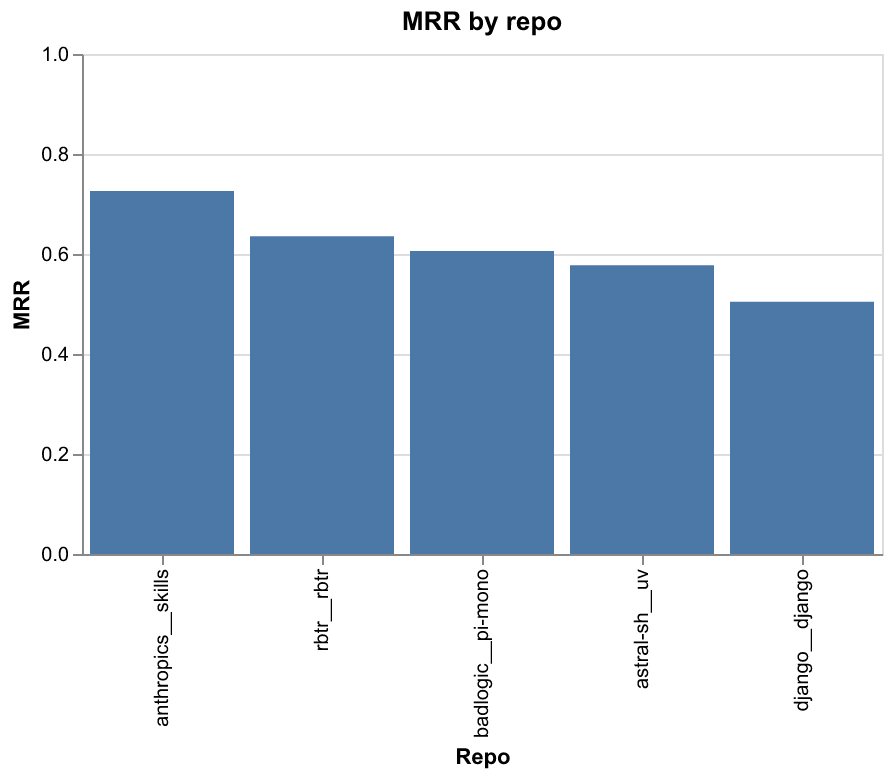
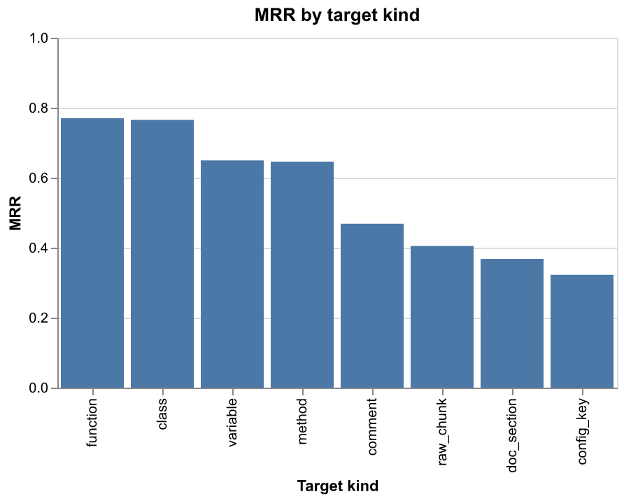
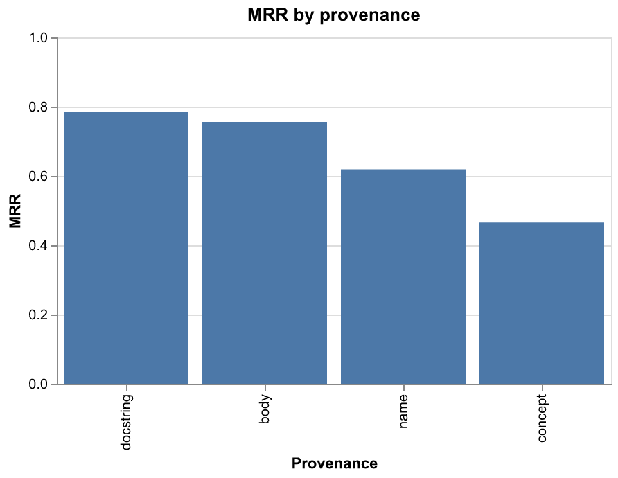

# rbtr search-quality benchmark

Hit@k / MRR / NDCG@10 for queries against the rbtr index. See
`packages/rbtr-eval/README.md` for methodology.

## Run

Reproduce: `cd packages/rbtr-eval && uv run dvc repro`.

| field         | value                                     |
| ------------- | ----------------------------------------- |
| seed          | 0                                         |
| sample target | 10 per (repo, language, kind, provenance) |
| total queries | 3629                                      |
| elapsed       | 71152 s                                   |

## Headline metrics

No-expansion baseline (arm `none`) per repo. The expansion
ablation is in the section below.

| repo                 | n    | Hit@1 | Hit@3 | Hit@10 | MRR   | NDCG@10 | median rank | not found |
| -------------------- | ---- | ----- | ----- | ------ | ----- | ------- | ----------- | --------- |
| **all repos**        | 3629 | 50.3% | 69.1% | 80.1%  | 0.607 | 0.654   | 1           | 19.9%     |
| `anthropics__skills` | 738  | 62.1% | 80.9% | 91.5%  | 0.726 | 0.772   | 1           | 8.5%      |
| `astral-sh__uv`      | 907  | 47.6% | 66.5% | 76.4%  | 0.578 | 0.623   | 1           | 23.6%     |
| `badlogic__pi-mono`  | 648  | 50.3% | 68.7% | 81.0%  | 0.606 | 0.656   | 1           | 19.0%     |
| `django__django`     | 747  | 41.6% | 57.4% | 68.0%  | 0.504 | 0.547   | 1           | 32.0%     |
| `rbtr__rbtr`         | 589  | 50.9% | 73.9% | 85.9%  | 0.636 | 0.691   | 1           | 14.1%     |

## Expansion ablation

MRR / Hit@k for each expansion arm (`none`, `keywords`,
`variants`, `both`) broken down by query kind, aggregated
across all repos. Compare arms within a kind to read the
effect of each channel.

| arm      | query kind   | n    | Hit@1 | Hit@3 | Hit@10 | MRR   | NDCG@10 |
| -------- | ------------ | ---- | ----- | ----- | ------ | ----- | ------- |
| both     | **all**      | 3629 | 47.8% | 67.0% | 77.5%  | 0.584 | 0.631   |
| keywords | **all**      | 3629 | 48.3% | 67.2% | 78.2%  | 0.588 | 0.635   |
| none     | **all**      | 3629 | 50.3% | 69.1% | 80.1%  | 0.607 | 0.654   |
| variants | **all**      | 3629 | 50.3% | 68.9% | 79.6%  | 0.606 | 0.652   |
| both     | `code`       | 580  | 72.2% | 88.3% | 90.9%  | 0.802 | 0.829   |
| keywords | `code`       | 580  | 72.1% | 88.3% | 90.9%  | 0.801 | 0.828   |
| none     | `code`       | 580  | 75.2% | 89.5% | 91.7%  | 0.822 | 0.846   |
| variants | `code`       | 580  | 75.3% | 89.5% | 91.7%  | 0.822 | 0.846   |
| both     | `concept`    | 1614 | 34.5% | 56.2% | 70.8%  | 0.467 | 0.526   |
| keywords | `concept`    | 1614 | 35.3% | 56.6% | 71.9%  | 0.474 | 0.533   |
| none     | `concept`    | 1614 | 35.4% | 55.9% | 71.4%  | 0.472 | 0.531   |
| variants | `concept`    | 1614 | 35.1% | 55.8% | 70.3%  | 0.468 | 0.525   |
| both     | `identifier` | 1435 | 52.9% | 70.7% | 79.7%  | 0.626 | 0.668   |
| keywords | `identifier` | 1435 | 53.4% | 70.6% | 80.1%  | 0.63  | 0.672   |
| none     | `identifier` | 1435 | 57.1% | 75.7% | 85.2%  | 0.672 | 0.716   |
| variants | `identifier` | 1435 | 57.4% | 75.3% | 85.1%  | 0.673 | 0.717   |

## Per-kind breakdown

Retrieval quality for each target chunk kind (`symbol_kind`),
aggregated across repos, languages and provenances.

| symbol_kind   | n   | Hit@1 | Hit@3 | Hit@10 | MRR   | NDCG@10 | not found |
| ------------- | --- | ----- | ----- | ------ | ----- | ------- | --------- |
| `function`    | 639 | 67.6% | 84.8% | 93.6%  | 0.77  | 0.811   | 6.4%      |
| `class`       | 641 | 66.9% | 85.2% | 91.9%  | 0.765 | 0.803   | 8.1%      |
| `variable`    | 755 | 52.8% | 74.6% | 88.2%  | 0.649 | 0.706   | 11.8%     |
| `method`      | 435 | 49.4% | 78.4% | 90.8%  | 0.646 | 0.711   | 9.2%      |
| `comment`     | 356 | 34.6% | 55.3% | 72.5%  | 0.469 | 0.53    | 27.5%     |
| `raw_chunk`   | 60  | 26.7% | 55.0% | 61.7%  | 0.405 | 0.457   | 38.3%     |
| `doc_section` | 403 | 31.8% | 39.0% | 49.9%  | 0.368 | 0.399   | 50.1%     |
| `config_key`  | 340 | 25.0% | 38.2% | 47.9%  | 0.323 | 0.36    | 52.1%     |

## Target × request shape

MRR for each target kind sliced by request shape (`query_kind`) —
which kinds search finds well, and via which kind of query.

| symbol_kind   | concept | identifier | code  |
| ------------- | ------- | ---------- | ----- |
| `class`       | 0.667   | 0.811      | 0.868 |
| `comment`     | 0.357   | 0.617      | 0.369 |
| `config_key`  | 0.226   | 0.385      | 0.536 |
| `doc_section` | 0.179   | 0.539      | 0.683 |
| `function`    | 0.668   | 0.798      | 0.918 |
| `method`      | 0.549   | 0.607      | 0.913 |
| `raw_chunk`   | 0.32    | 0.461      | 0.52  |
| `variable`    | 0.514   | 0.733      | 0.81  |

## Search latency

| repo                 | search P50 | search P95 |
| -------------------- | ---------- | ---------- |
| **all repos**        | 4291 ms    | 9713 ms    |
| `anthropics__skills` | 5095 ms    | 11051 ms   |
| `astral-sh__uv`      | 4485 ms    | 10631 ms   |
| `badlogic__pi-mono`  | 3693 ms    | 8670 ms    |
| `django__django`     | 4406 ms    | 9302 ms    |
| `rbtr__rbtr`         | 3876 ms    | 8291 ms    |

## Per-language breakdown

Aggregated across all repos for each language present in the sample.

| language     | n   | Hit@1 | Hit@3 | Hit@10 | MRR   | NDCG@10 | median rank | not found |
| ------------ | --- | ----- | ----- | ------ | ----- | ------- | ----------- | --------- |
| `bash`       | 391 | 62.9% | 76.7% | 86.7%  | 0.707 | 0.746   | 1           | 13.3%     |
| `css`        | 349 | 57.9% | 82.2% | 94.8%  | 0.711 | 0.769   | 1           | 5.2%      |
| `html`       | 39  | 30.8% | 33.3% | 38.5%  | 0.328 | 0.341   | 1           | 61.5%     |
| `javascript` | 427 | 58.8% | 78.7% | 85.5%  | 0.693 | 0.733   | 1           | 14.5%     |
| `json`       | 197 | 19.8% | 34.5% | 45.7%  | 0.279 | 0.321   | 2           | 54.3%     |
| `markdown`   | 198 | 28.3% | 37.9% | 51.0%  | 0.346 | 0.385   | 1           | 49.0%     |
| `plaintext`  | 60  | 26.7% | 55.0% | 61.7%  | 0.405 | 0.457   | 2           | 38.3%     |
| `python`     | 887 | 59.6% | 79.5% | 88.5%  | 0.701 | 0.746   | 1           | 11.5%     |
| `rst`        | 70  | 20.0% | 21.4% | 31.4%  | 0.223 | 0.244   | 1           | 68.6%     |
| `rust`       | 251 | 47.0% | 68.5% | 85.3%  | 0.594 | 0.656   | 1           | 14.7%     |
| `sql`        | 80  | 51.2% | 75.0% | 93.8%  | 0.657 | 0.725   | 1           | 6.2%      |
| `toml`       | 70  | 41.4% | 47.1% | 52.9%  | 0.448 | 0.467   | 1           | 47.1%     |
| `typescript` | 517 | 48.5% | 72.5% | 86.7%  | 0.621 | 0.682   | 1           | 13.3%     |
| `yaml`       | 93  | 24.7% | 39.8% | 51.6%  | 0.332 | 0.376   | 2           | 48.4%     |

## Per-provenance breakdown

Aggregated across all repos and languages for each provenance.

| provenance  | n    | Hit@1 | Hit@3 | Hit@10 | MRR   | NDCG@10 | median rank | not found |
| ----------- | ---- | ----- | ----- | ------ | ----- | ------- | ----------- | --------- |
| `body`      | 967  | 66.6% | 84.1% | 89.7%  | 0.756 | 0.791   | 1           | 10.3%     |
| `concept`   | 1564 | 34.7% | 55.2% | 70.8%  | 0.465 | 0.524   | 2           | 29.2%     |
| `docstring` | 389  | 70.7% | 86.6% | 89.7%  | 0.786 | 0.814   | 1           | 10.3%     |
| `name`      | 709  | 51.6% | 69.8% | 82.4%  | 0.619 | 0.669   | 1           | 17.6%     |

## Truncation impact

MRR breakdown by whether the target chunk's embedding was truncated
to fit the context window.

| embedding | n     | MRR   |
| --------- | ----- | ----- |
| full      | 14324 | 75.7% |
| truncated | 192   | 60.3% |
